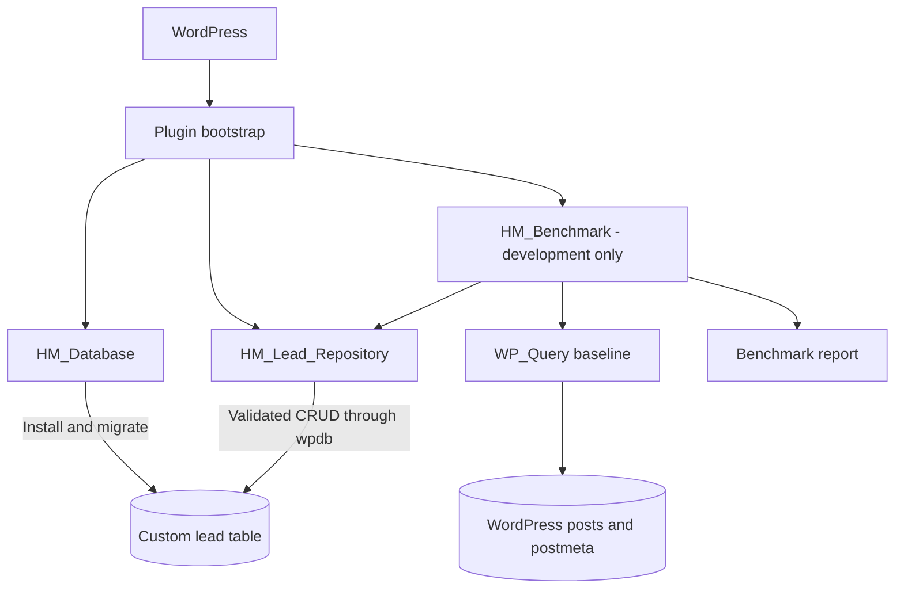

# HM Custom Table Engine

An object-oriented WordPress plugin specification for managing structured business data in dedicated MySQL tables. The initial use case is property lead management, with a reusable database manager and repository architecture for future business workflows.

**Plugin folder:** `hm-custom-table-engine`  
**Status:** Plugin source implemented; WordPress integration and benchmark execution remain unverified.

## 1. Project overview and delivery status

WordPress posts and post metadata remain appropriate for editorial content. This project proposes a dedicated, typed table for lead records that need predictable filtering, pagination, and indexing. Performance benefits must be measured against an equivalent WordPress metadata implementation rather than assumed.

This README is the source of truth for implementation. Normative requirements describe intended behavior, not working features. The initial workspace contained no plugin source files or test reports. Implementation files have since been added under this plugin folder.

| Area | Evidence / status |
| --- | --- |
| Architecture and API contracts | Specified in this README |
| Plugin bootstrap, database manager, repository | Implemented in source; runtime unverified |
| Installation and baseline schema lifecycle | Implemented in source; runtime unverified |
| CRUD, filtering, pagination, security | Implemented in source; runtime unverified |
| Benchmark runner and fixtures | Implemented in source; not executed |
| Verified performance results | None; no measurements have been collected |

Update these statuses only when linked source code, test evidence, or reproducible reports support the change. Code examples below are design examples, not delivered plugin code.

## 2. Planned features

- A site-specific custom table with typed lead fields and workload-driven indexes.
- Table installation and versioned schema upgrades through a dedicated database manager.
- An `HM_Lead_Repository` class for validated CRUD operations.
- Status and minimum-budget filters, combined filtering, and creation-date sorting.
- Bounded page sizes, deterministic pagination, and matching total counts.
- Safe WordPress database operations with consistent error contracts.
- Explicit lifecycle rules that preserve business data by default.
- A repeatable comparison of custom-table queries and `WP_Query` over 5,000 equivalent records.

No administrative screens, REST routes, public forms, or scheduled jobs are included in the initial scope. Future entry points must enforce the security contracts in this document.

## 3. Technical stack and standards

| Component | Target |
| --- | --- |
| CMS | WordPress; proposed minimum 6.2 for `%i` identifier placeholders |
| Runtime | PHP 8.2, 64-bit |
| Database | MySQL 8.4, InnoDB |
| Development environment | LocalWP |
| Database access | WordPress `$wpdb` |
| Schema management | `dbDelta()` plus explicit versioned migrations |
| Architecture | Object-oriented PHP; repository pattern |
| Standards | WordPress Coding Standards, WordPress-native APIs, PHPDoc |

The WordPress minimum is a design choice, not a verified compatibility claim. Record the exact WordPress, PHP, MySQL, and LocalWP versions used in test reports. Confirm the actual database server version with `SELECT VERSION()`; do not assume a LocalWP installation provides MySQL 8.4. If necessary, configure an appropriate development database before validation.

Use prefixed classes and functions, explicit dependencies, small methods, documented return contracts, and direct-access guards in executable PHP files. Keep database access out of presentation code. PHPDoc must describe argument shapes, validation, return types, and failure behavior. Run PHP syntax checks and WordPress Coding Standards checks when source files exist.

## 4. Architecture and execution flow



### Responsibilities

| Component | Responsibility |
| --- | --- |
| Bootstrap | Declare plugin metadata, check runtime requirements, load classes, register lifecycle hooks, and wire dependencies |
| `HM_Database` | Derive the current site's table name, define schema, install indexes, manage schema versions and upgrades, verify installation, and expose readiness |
| `HM_Lead_Repository` | Validate domain data, construct queries, run CRUD operations, normalize rows, and return consistent errors |
| `HM_Benchmark` | Create isolated equivalent fixtures, execute controlled experiments, collect measurements, and produce reproducible reports |
| Request/controller layer, when added | Enforce capabilities and request authenticity, map input to repository calls, and escape rendered output |

The bootstrap registers `register_activation_hook()` against the main plugin file. Normal startup checks the stored schema version because plugin updates do not necessarily run activation hooks. Repository operations must fail with a controlled error when schema installation or upgrade has not succeeded.

The normal query flow is: authorized caller → input validation → repository → trusted SQL structure and prepared values → `$wpdb` → immediate database error check → normalized result or `WP_Error` → escaped presentation. The repository must be usable without an HTTP request; nonces belong at the request boundary.

## 5. Proposed directory structure

```text
hm-custom-table-engine/
├── hm-custom-table-engine.php
├── uninstall.php
├── README.md
├── includes/
│   ├── class-hm-database.php
│   ├── class-hm-lead-repository.php
│   └── class-hm-benchmark.php
├── tests/
│   └── manual-test-plan.md
└── reports/
    └── performance-benchmark.md
```

The plugin source, manual test plan, and pending benchmark report now exist in this folder.

| File | Purpose |
| --- | --- |
| `hm-custom-table-engine.php` | Plugin header, constants, class loading, dependency setup, activation/deactivation hooks, upgrade dispatch |
| `uninstall.php` | Guarded cleanup that follows the explicit retention policy |
| `includes/class-hm-database.php` | `HM_Database` schema definition, table naming, installation verification, migrations |
| `includes/class-hm-lead-repository.php` | `HM_Lead_Repository` CRUD, filtering, pagination, validation, error mapping |
| `includes/class-hm-benchmark.php` | `HM_Benchmark` fixture management, timing, memory profiling, and results collection |
| `tests/manual-test-plan.md` | Repeatable test steps, expected results, environment, actual results, and evidence |
| `reports/performance-benchmark.md` | Dataset definition, query SQL, plans, raw samples, summaries, and limitations |

## 6. Database architecture and schema

The table name is **`{$wpdb->prefix}custom_lead_logs`**. Always resolve it from the current site's `$wpdb->prefix`; never hard-code `wp_` or accept a table name from request input.

Despite its name, the initial table stores the current lead state. Updating a status overwrites that state; this is not an append-only audit log.

| Column | SQL type | Constraints and meaning |
| --- | --- | --- |
| `id` | `BIGINT UNSIGNED` | Non-null, auto-increment primary key; unique lead identity |
| `client_name` | `VARCHAR(100)` | Non-null, sanitized and non-empty; at most 100 characters |
| `property_id` | `BIGINT UNSIGNED` | Non-null; positive ID of an existing property post |
| `status` | `VARCHAR(50)` | Non-null; validated canonical status; default `new` |
| `budget` | `DECIMAL(10,2)` | Non-null; exact fixed-point amount, validated from `0.00` to `99999999.99` |
| `created_at` | `DATETIME` | Non-null; UTC creation time supplied by the application |

`BIGINT UNSIGNED` aligns with WordPress-style identifiers, but PHP integers cannot represent its entire unsigned range. The initial API accepts positive IDs only through `PHP_INT_MAX` on 64-bit PHP; reject overflow rather than silently coercing it. `VARCHAR` limits are character lengths, so validation must handle multibyte input correctly. `DECIMAL` avoids binary floating-point storage errors. Pass budgets as normalized decimal strings and preserve them as strings in returned records.

Use one configured business currency; this schema has no currency field and cannot safely represent mixed currencies. Currency choice is a deployment requirement. Allowed status values are `new`, `contacted`, `qualified`, `won`, and `lost`; expanding this set requires deliberate validation and migration review.

### Proposed installation SQL

```php
// Design example inside the database manager; not a complete installer.
global $wpdb;

$table_name      = $wpdb->prefix . 'custom_lead_logs';
$charset_collate = $wpdb->get_charset_collate();

require_once ABSPATH . 'wp-admin/includes/upgrade.php';

$sql = "CREATE TABLE {$table_name} (
id bigint unsigned NOT NULL AUTO_INCREMENT,
client_name varchar(100) NOT NULL,
property_id bigint unsigned NOT NULL,
status varchar(50) NOT NULL DEFAULT 'new',
budget decimal(10,2) NOT NULL,
created_at datetime NOT NULL,
PRIMARY KEY  (id),
KEY property_id (property_id),
KEY created_at_id (created_at,id),
KEY status_created_at_id (status,created_at,id)
) ENGINE=InnoDB {$charset_collate};";

dbDelta( $sql );
```

The table identifier and charset clause above come solely from trusted WordPress configuration. Match `dbDelta()`'s expected SQL layout, load its upgrade helper, and inherit the site's character set and collation. See the official [table creation guide](https://developer.wordpress.org/plugins/creating-tables-with-plugins/) and [`dbDelta()` reference](https://developer.wordpress.org/reference/functions/dbdelta/).

### Relationships and data integrity

`property_id` is a logical relationship to `{$wpdb->posts}.ID`. The application must confirm the referenced post exists and has the configured property post type. This plugin does not register the `property` post type; the integrating site must register it. Inserts and property-ID updates return `hm_invalid_property` when the type is unavailable, the post is missing, or it has a different type.

No database foreign key or cascading deletion is proposed. This avoids coupling lead deletion to WordPress post deletion, but application checks alone cannot eliminate all concurrent orphaning. Preserve leads when properties are removed, display a missing-property state, and provide a future integrity audit. Recheck references on insert and when changing `property_id`.

The primary key prevents duplicate identities; it does not prevent duplicate submissions. Required fields use `NOT NULL`, while validation enforces business rules that SQL types alone cannot express. Set `created_at` with `current_time( 'mysql', true )`; ordinary updates cannot modify it. Use explicit transactions for future multi-write business operations where atomicity is required.

## 7. Installation, schema versions, and migrations

Use a code-level schema version independent of the plugin release version, initially proposed as `1.0.0`, and store the successful version in `hm_cte_schema_version`.

1. Check environment compatibility before installation.
2. Acquire a bounded, atomic migration lock to avoid concurrent upgrades; define stale-lock recovery.
3. Resolve the site table and call `dbDelta()` for compatible table/column/index additions or changes.
4. Run explicit, ordered migration steps for data transformations and changes that `dbDelta()` does not safely handle.
5. Inspect database errors immediately, then verify actual columns, types, and indexes with schema inspection queries.
6. Save the new schema version only after all required postconditions succeed, and release the lock on every exit path.

Do not treat an empty `dbDelta()` result as proof of either success or failure. Re-running installation must be safe and must preserve records. Never run schema changes on every ordinary request once the stored version matches.

Migrations must be idempotent or record resumable progress, keep existing data readable where feasible, and backfill large tables in bounded batches. Renames, destructive changes, and data conversions need explicit reviewed migrations and a backup/restore plan. MySQL DDL may implicitly commit, so a transaction is not a general schema rollback mechanism. On failure, keep the prior schema version, report an administrator-visible error, and prevent incompatible repository access. Do not automatically downgrade schemas.

Return actionable error codes without exposing SQL or client data to visitors. Restricted development logs may include sanitized diagnostic context; avoid credentials and personal data.

## 8. SQL indexing and query optimization

| Index | Planned workload | Trade-off |
| --- | --- | --- |
| `PRIMARY KEY (id)` | Point reads, updates, deletes, deterministic tie-breaker | Maintained on inserts |
| `KEY property_id (property_id)` | Property relationship lookups and future property-specific queries | Additional write and storage cost |
| `KEY created_at_id (created_at, id)` | Unfiltered creation-date pagination | Does not directly optimize status or budget predicates |
| `KEY status_created_at_id (status, created_at, id)` | Status equality followed by creation-date ordering | Benefits depend on status distribution and result size |
| Candidate `KEY budget (budget)` | Selective minimum-budget ranges | May still require a date sort; add only after measurement |
| Candidate `KEY status_budget_created_id (status, budget, created_at, id)` | Status equality plus selective budget range | A budget range can prevent later columns from satisfying date ordering |

Composite index column order must match real predicates and ordering. Low-cardinality status values may have weak selectivity; a status-only index may be redundant with the status-leading composite. Avoid installing every candidate index by default. More indexes increase storage and insert/update/delete cost.

Capture `SHOW INDEX` output and inspect representative queries with `EXPLAIN`. Compare chosen keys, access methods, estimated rows, filtering, sorting, and temporary work. Use `EXPLAIN ANALYZE` on the MySQL 8.4 development database to compare estimates with actual rows, loops, and timing; it executes the query, so run it separately from timing trials. See the [MySQL EXPLAIN reference](https://dev.mysql.com/doc/refman/8.4/en/explain.html).

Test common and rare statuses, low and high budget thresholds, and deep pages. Record data distribution and index definitions before drawing conclusions. Recheck execution plans after index changes; report read improvements alongside write costs.

## 9. Repository and CRUD contracts

Inject the WordPress database object into `HM_Lead_Repository`; derive the table internally from the active site context. Do not accept arbitrary SQL fragments, table names, or field names from callers. Recreate or rebind site-specific repositories after switching blogs in any future multisite integration.

All methods return `WP_Error` on validation or database failure. Distinguish database failures from empty result sets, missing records, and successful no-op updates.

| Method | Proposed arguments | Successful result | Database mechanism |
| --- | --- | --- | --- |
| `insert_lead()` | `$data`: name, property ID, budget; optional status | New positive integer ID | `$wpdb->insert()` with explicit formats |
| `get_lead()` | `$id` | Normalized associative row, or `null` if absent | Prepared query with `$wpdb->get_row()` |
| `get_all_leads()` | `$args = []`: page, per-page, order | Paginated collection | Same bounded query pipeline as filtered reads |
| `get_filtered_leads()` | `$args = []`: status, minimum budget, page, per-page, order | Paginated collection | Prepared data and count queries |
| `update_lead()` | `$id`, `$data`: allowed mutable fields | Affected row count: `0` or `1` | `$wpdb->update()` with explicit formats |
| `update_status()` | `$id`, `$status` | Affected row count: `0` or `1` | Delegate to validated update logic |
| `delete_lead()` | `$id` | Deleted row count: `0` or `1` | `$wpdb->delete()` with explicit formats |

For update methods, `0` means unchanged or no matching row; it is not an error. Delete returns `0` when absent. Callers needing a missing-record distinction can perform a read, acknowledging concurrency between calls. Use strict `false === $result` checks for writes, and inspect `$wpdb->last_error` immediately after reads because some read results alone do not distinguish errors from emptiness.

Reject unknown input fields and empty update payloads. Allow updates only to `client_name`, `property_id`, `status`, and `budget`. IDs and timestamps are repository-controlled. Normalize returned rows to integer IDs, string names/statuses, decimal-string budgets, and UTC datetime strings. SQL projection should list these fields explicitly.

Use `%d` for validated integers and `%s` for strings, including validated fixed-point budgets. Let `$wpdb->insert()`, `update()`, and `delete()` handle their data formats; do not manually pre-escape values. Use `prepare()` for custom SQL. Identifier placeholders `%i` require WordPress 6.2 or later; identifiers must still be drawn from trusted application choices. See [`wpdb`](https://developer.wordpress.org/reference/classes/wpdb/) and [`wpdb::prepare()`](https://developer.wordpress.org/reference/classes/wpdb/prepare/).

### Secure combined filtering

Supported filter keys are `status` and `min_budget`, combined with `AND`. Omitted filters impose no constraint. Reject empty or invalid supplied filters; a minimum budget of `0.00` is valid and must not disappear through a truthiness check.

Build dynamic SQL from fixed clauses and a parallel parameter array:

```php
// Design fragment: inputs must already satisfy the repository contract.
$where  = array( '1=1' );
$params = array( $table_name );

if ( isset( $filters['status'] ) ) {
    $where[]  = 'status = %s';
    $params[] = $filters['status'];
}
if ( isset( $filters['min_budget'] ) ) {
    $where[]  = 'budget >= %s';
    $params[] = $filters['min_budget'];
}

$direction = 'ASC' === $order ? 'ASC' : 'DESC';
$sql       = 'SELECT id, client_name, property_id, status, budget, created_at
    FROM %i WHERE ' . implode( ' AND ', $where ) .
    " ORDER BY created_at {$direction}, id {$direction} LIMIT %d OFFSET %d";
$params[]  = $per_page;
$params[]  = $offset;
$rows      = $wpdb->get_results( $wpdb->prepare( $sql, $params ), ARRAY_A );
```

Reject invalid sort directions during validation; the fragment's fallback is defensive. SQL keywords such as `ASC` cannot be supplied as value placeholders: select them from a fixed allowlist. Reuse the same validated predicates and filter parameters for `COUNT(*)`, excluding order, limit, and offset.

## 10. Pagination architecture

- Default `page`: `1`; accept only positive integers.
- Default `per_page`: `20`; accept integers from `1` to `100`, rejecting larger values.
- Default ordering: `created_at DESC, id DESC`; also support both columns ascending.
- Compute `offset = (page - 1) * per_page` after validation; reject integer overflow.
- Fetch at most one page using prepared `LIMIT %d OFFSET %d` values.
- Count all matching rows with identical filters and no pagination.
- Return `items`, `page`, `per_page`, `total`, and `total_pages = ceil(total / per_page)`.
- For zero matches, return empty items, total `0`, and total pages `0`. A page beyond the end returns empty items while retaining the actual total.

The unique ID tie-breaker makes equal timestamps deterministic. Separate data/count queries can observe concurrent changes; the initial contract provides no cross-query snapshot guarantee. Document this behavior in integrations. Offset pagination may also shift between requests when records change.

For large datasets, consider keyset pagination with the last row's `(created_at, id)` as a validated cursor. Descending continuation uses `created_at < cursor_time OR (created_at = cursor_time AND id < cursor_id)`, with the same filters and descending ordering. Keyset pagination avoids scanning large offsets but does not naturally provide arbitrary page jumps; exact total counting remains a separate cost.

## 11. Performance benchmarking methodology

**No benchmark results are available.** Dedicated tables are a hypothesis to evaluate, not a verified performance claim.

### Equivalent 5,000-record fixtures

Create exactly 5,000 synthetic leads in each representation from one deterministic seed and manifest. Never use real client data. Include identical names, valid property references, status distribution, fixed-point budgets, UTC timestamps, and deliberately repeated timestamps.

The comparison representation uses one benchmark-only custom post per lead, with metadata for `client_name`, `property_id`, `status`, and `budget`, and a matching creation date. Set both local and GMT post date fields consistently with the custom UTC timestamp. Preserve insertion order and record the custom-ID-to-post-ID mapping so timestamp tie-breaking selects equivalent logical rows. Keep all benchmark posts in one explicit post status.

Use `WP_Query` with `meta_query` relation `AND`: status equality and budget `>=` with type `DECIMAL(10,2)`. Use `orderby` date plus ID in the matching direction, the same page size/page, an explicit benchmark post type/status, and totals enabled when the custom-table case counts totals. Document any hooks affecting `WP_Query`.

Verify equivalent matching IDs and counts before timing. Use a development-only fixture manifest so cleanup deletes only benchmark records and the benchmark's own posts; never truncate a table containing business data.

### Comparison workloads

Measure unfiltered pages, status filtering, budget filtering, combined status/budget filtering, no matches, and deeper pages. The required headline comparison is the combined-filter workload with multiple metadata conditions. Specify every threshold, direction, and page in the report.

Separate these scopes:

1. **Database query comparison:** capture custom SQL and actual SQL emitted by `WP_Query`, including count-related work, and profile their database calls and execution plans.
2. **End-to-end PHP comparison:** custom repository versus `WP_Query`, including equivalent output shaping and total counts. When returning full lead records, include metadata retrieval on the WordPress side. If testing IDs only, use IDs only on both sides.

Do not label WordPress object construction or metadata retrieval as pure database time. Do not compare a custom data-only query against a WordPress query that also counts totals without reporting that difference.

### Measurements and instrumentation

| Metric | Required method and interpretation |
| --- | --- |
| Database call time | Sum relevant `$wpdb` timings from a separate `SAVEQUERIES` profiling pass; record data, count, and metadata calls. This includes client-side call overhead, not solely server CPU time. |
| PHP elapsed time | `timer_start()` immediately before the operation and `(float) timer_stop( 0, 6 )` immediately after; report seconds or convert explicitly to milliseconds |
| Memory change | Difference in `memory_get_usage()` before and after the measured operation; record bytes and whether allocated or used memory is measured |
| Peak memory | `memory_get_peak_usage()` with a recorded baseline and peak reset where available; isolate each sample in a fresh process/request |
| Database query count | Difference in `$wpdb->num_queries` across the operation |
| Execution plans | Saved `EXPLAIN` and separately collected `EXPLAIN ANALYZE` output for representative SQL |

Timers measure elapsed operation time, including database waits; they do not isolate PHP CPU time. WordPress timers use shared state, so avoid overlapping timer regions. `SAVEQUERIES` retains query data and adds time/memory overhead: disable it for primary wall-time and memory trials and enable it in separately labeled diagnostic runs. Peak memory is process-wide unless reset; an unreset request peak cannot be attributed solely to a query. Record `memory_reset_peak_usage()` use under PHP 8.2 where available.

### Repeatability and cache controls

1. Record hardware, OS, LocalWP configuration, exact software versions, PHP limits, database settings, active plugins, schema, indexes, and fixture seed.
2. Run at least 5 excluded warm-up operations per scenario and at least 30 measured operations per scenario and implementation.
3. Alternate or randomize implementation order to reduce drift; use isolated requests/processes and the same output contract.
4. Report all raw samples, arithmetic mean, median, minimum, maximum, and sample count. Do not silently discard slow samples; explain any excluded run.
5. Separate uncached application-query trials from warm-cache application trials. Explicitly record `cache_results`, post/meta cache priming flags, persistent object-cache state, and cache-clearing procedures. Use a disposable environment for cache resets.
6. For database-access comparisons, disable WordPress result caching on the baseline and keep plugin-side caching disabled. Record unavoidable cache work and keep output requirements equal.
7. Record whether PHP OPcache and the InnoDB buffer pool are warm. Clearing WordPress caches does not empty the database buffer pool. Do not call a run database-cold without a controlled reset. MySQL 8.4 has no legacy SQL query cache.
8. Collect query plans separately. State that `EXPLAIN ANALYZE` instrumentation can affect execution time.

Store results in `reports/performance-benchmark.md` when implemented. Include the fixture manifest, generated SQL, configuration, raw data, calculations, plans, and reproduction steps.

| Measurement | Custom table | WP_Query + metadata |
| --- | --- | --- |
| Dataset size | Planned: 5,000 | Planned: 5,000 |
| Mean / median database call time | Not measured | Not measured |
| Mean / median PHP elapsed time | Not measured | Not measured |
| Memory change / peak bytes | Not measured | Not measured |
| Database queries per operation | Not measured | Not measured |
| Verified execution plans | Not collected | Not collected |

Do not publish a speedup ratio until both measurements have matching scopes and documented conditions. A 5,000-row test cannot establish production-scale behavior.

## 12. Security and validation architecture

| Boundary | Required control |
| --- | --- |
| Request input | Unslash WordPress request strings before sanitization; validate shape and reject unexpected fields |
| Client name | Use `sanitize_text_field()`, then enforce non-empty content and a 100-character limit |
| IDs and pagination | Validate integer syntax, positivity, bounds, and overflow before conversion; do not turn negative IDs into valid positive IDs |
| Status | Require an exact canonical value from the documented allowlist |
| Budget | Accept plain non-negative decimal strings with at most two fractional digits; reject exponent notation, currency symbols, separators, overflow, and excess precision; normalize to two digits |
| Property relationship | Verify existence and configured post type on insert or property changes |
| SQL values | Use database API formats or `prepare()` placeholders; never concatenate input into SQL |
| SQL identifiers and ordering | Internally derive table names and allowlist fields/directions; escaping is not authorization |
| Authorization | Initial admin-only entry points require `current_user_can( 'manage_options' )`; any broader integration must define an explicit capability policy |
| Request authenticity | Verify action-specific nonces for cookie-authenticated writes, using appropriate admin/AJAX/REST mechanisms |
| Output | Escape at rendering time using context-appropriate APIs such as `esc_html()`, `esc_attr()`, and `esc_url()`; use native JSON responses |
| Errors and logs | Return stable `WP_Error` codes and safe messages; restrict diagnostics and redact personal information |

Sanitization does not replace business validation, prepared SQL does not replace authorization, and nonces do not grant permission. Avoid storing pre-escaped display strings. The benchmark runner must be restricted to authorized local/development execution and must not expose an unauthenticated endpoint.

Suggested error codes include `hm_invalid_input`, `hm_invalid_property`, `hm_schema_unavailable`, and `hm_database_error`. Database outages, missing tables, and failed writes must never be returned as successful empty collections.

## 13. Plugin lifecycle and data retention

| Event | Required behavior |
| --- | --- |
| Activation | Check compatibility, install/verify schema, save version only on success; do not create benchmark fixtures |
| Normal startup / upgrade | Compare schema versions and run controlled pending migrations before incompatible operations |
| Deactivation | Remove temporary locks or future scheduled work owned by the plugin; preserve all leads, schema, and retention preferences |
| Uninstall, default | Retain the custom table and its schema-version metadata for later recovery/reinstallation; clear disposable plugin runtime state |
| Uninstall, explicit opt-in | Delete the exact site table and plugin-owned options only when a previously confirmed destructive-cleanup preference is enabled |

The proposed cleanup preference is `hm_cte_delete_data_on_uninstall`, default `false`. A future settings flow must require administrator capability, nonce verification, a clear permanent-deletion explanation, and affirmative confirmation before storing `true`. Until that flow exists, uninstall must retain business data.

`uninstall.php` must check `WP_UNINSTALL_PLUGIN` before doing anything. Resolve the exact trusted table name and never use wildcard table deletion. Do not delete WordPress properties or unrelated metadata. Recommend an export/backup before opt-in removal. Use the WordPress uninstall mechanism; deactivation must never call destructive cleanup.

Initial support is single-site. Reject network activation until per-site provisioning, new-site handling, blog switching, and network-wide cleanup are implemented and tested. Dynamic prefixes alone do not constitute multisite support.

## 14. Installation instructions

**Plugin source is present, but activation has not yet been verified in a running WordPress installation.** The following procedure applies after the proposed PHP files have been implemented.

1. Create a disposable WordPress site in LocalWP and verify PHP 8.2 and MySQL 8.4.
2. Verify the supported WordPress version, configure the site's business currency and property post type, and create valid test properties.
3. Back up the database before using an existing site.
4. Place the complete plugin directory at `wp-content/plugins/hm-custom-table-engine/`.
5. Activate **HM Custom Table Engine** in WordPress administration.
6. Confirm the prefixed `custom_lead_logs` table, required columns/indexes, charset/collation, and stored schema version.
7. Execute the manual tests on synthetic data and inspect restricted development logs for failures.

No command-line interface, package installer, demo UI, or automatic seeder is currently provided. Document their actual usage only if implemented.

## 15. Testing instructions and acceptance criteria

Implement `tests/manual-test-plan.md` with prerequisites, actions, expected results, actual results, pass/fail status, and evidence links. Run on a disposable target environment with a non-default table prefix as well as the ordinary configuration. No cases below have been executed in a running WordPress installation.

| Area | Required cases and acceptance criteria |
| --- | --- |
| Table creation | Fresh activation creates exactly the intended table with required types, primary key, secondary indexes, and site collation; repeated installation preserves rows |
| Activation | Compatible environment succeeds; incompatible runtime and missing database privileges produce a controlled failure without falsely marking schema success |
| Insert/read | Insert a valid lead and read identical normalized values; test multibyte names, budget boundaries, UTC timestamp, unique IDs, and missing reads returning `null` |
| Update | Change each allowed field, update status, repeat an unchanged update, and update a missing ID; reject immutable/unknown fields and empty payloads |
| Delete | Delete an existing lead, repeat deletion, and verify other rows and referenced properties remain intact |
| Filtering | Status only, budget only, combined filters, zero minimum, no matches, invalid statuses, and ascending/descending dates |
| Pagination | First/last/beyond-end pages, zero results, equal timestamps, exact totals, default values, max size 100, rejected size 101, negative/zero inputs, and offset overflow |
| Invalid input | Empty/oversized names, invalid UTF-8 handling, nonexistent/wrong-type property, malformed IDs, overflow, negative budget, excess precision, and out-of-range budget |
| SQL injection | Quote/comment payloads in values, attempted sort/field injection, and malicious IDs do not change SQL structure or broaden access |
| Output security | Stored markup renders safely in any added UI; unauthorized callers and missing/invalid nonces cannot mutate data |
| Database errors | Simulate missing table, denied writes, and query failure; assert `WP_Error`, safe diagnostics, and no false-success results |
| Index verification | Inspect `SHOW INDEX`; save plans for representative workloads; assess candidate indexes against both reads and writes |
| Benchmarking | Both representations have exactly 5,000 equivalent fixture rows; logical results/counts match; warm-ups, repetitions, raw samples, cache settings, mean, and median are recorded |
| Memory profiling | Record before/after bytes and isolated/reset peak measurements; disclose retained results, instrumentation, and process boundaries |
| Deactivation | Deactivate/reactivate and verify all business records and schema remain intact |
| Uninstallation | Default uninstall retains data; explicit opt-in removes only plugin-owned table/options; direct execution is blocked |
| Schema migrations | Upgrade a previous populated schema, verify preservation/backfills, retry after injected failure, and test concurrent upgrade attempts and unchanged version on failure |
| Relationships | Property deletion preserves the lead; subsequent reads expose a missing reference safely |
| Multisite boundary | Unsupported network activation is rejected without partial installation |

When source exists, run PHP syntax checks and WordPress Coding Standards, then execute the functional and lifecycle plan. Automated integration tests should use a real WordPress test database for schema and `$wpdb` behavior. Record source revision and environment with every report. Never mark planned tests as passed based on documentation review alone.

## 16. Known limitations

- Plugin source and a manual test plan are delivered; no WordPress integration tests or benchmark measurements have been run.
- Supported versions are targets awaiting runtime validation.
- The `property` post type must be registered by the integrating site before lead writes; the business currency remains a site integration decision.
- Leads contain personal data; retention periods, access policy, and future export/erasure integration require deployment-specific decisions.
- There is no audit history, deduplication key, currency column, or optimistic concurrency control. Concurrent edits currently imply last-write-wins semantics.
- Logical property relationships can become orphaned; no foreign-key enforcement is planned initially.
- Exact counts and deep offsets may become expensive; index effectiveness depends on data distribution.
- Separate count/data queries and multiple pagination requests do not guarantee a consistent snapshot during concurrent writes.
- Multisite, admin UI, REST access, background migrations, and custom result caching are not initially supported.
- No performance advantage or production capacity has been verified.

## 17. Future improvements

- Keyset pagination and optional count-free list endpoints for larger datasets.
- Workload-validated budget indexes and explicit read/write benchmark comparisons.
- Custom capabilities, authenticated administration/REST interfaces, and privacy export/erasure integration.
- Currency-aware amounts, configurable status workflows, audit history, and idempotent submission keys.
- Optimistic locking and transaction-based multi-record workflows.
- Automated integration tests, continuous standards checks, and version compatibility testing.
- Resumable background migrations and multisite provisioning after explicit lifecycle design.
- Carefully invalidated caching only after uncached behavior is measured and correct.

Changes to these contracts must update this README, relevant migrations, tests, and benchmark documentation together.

## Isolated test environment

The project now includes [`docker-compose.yml`](docker-compose.yml) and a [separate test procedure](tests/ISOLATED-TESTING.md). This Docker stack creates its own WordPress installation and MySQL 8.4 database; it does not use or mount any existing LocalWP site. The test procedure includes activation, integration, benchmark, retention, and cleanup commands. A Docker or Podman executable was not available on the development host, so these integration and performance commands have not been run. PHP 8.2.29 syntax checks passed for all seven current PHP files. The performance report contains no measured results.

## 18. LocalWP test setup and current verification

Use a **new disposable LocalWP site** with WordPress 6.2 or later, PHP 8.2, and MySQL 8.4. In LocalWP's site Overview, select the PHP and database versions, then start the site. Verify the actual server with `SELECT VERSION()` in the site's database tool. Existing LocalWP sites were not modified during this review.

Copy the entire `hm-custom-table-engine` folder into the site's `app/public/wp-content/plugins/` directory. In the site's `app/public/wp-config.php`, enable `WP_DEBUG` and set `WP_ENVIRONMENT_TYPE` to `local` for benchmark testing. Open **Site Shell** in LocalWP and run these commands from the WordPress root:

```sh
wp core version
wp eval 'echo PHP_VERSION . " / " . $GLOBALS["wpdb"]->db_version() . PHP_EOL;'
wp plugin activate hm-custom-table-engine
wp eval-file wp-content/plugins/hm-custom-table-engine/tests/integration.php
```

The integration script temporarily registers `property` if the site does not provide it, creates disposable posts and leads, checks installation, CRUD, validation, filtering, pagination, and input rejection, then removes its fixtures. It does **not** test uninstall. Test activation with a non-default prefix on a second disposable site. To check uninstall retention, add a lead, deactivate and delete the plugin through WordPress, then inspect the table; by default it must remain. Only test opt-in deletion on a separate disposable site after setting `hm_cte_delete_data_on_uninstall` to Boolean `true` through a trusted administrator-controlled operation and backing up the site.

For performance testing, the Site Shell must execute as an administrator WordPress user (for example, use a temporary `wp_set_current_user()` call inside an explicitly local CLI harness). Instantiate `new HM_Benchmark( $GLOBALS['wpdb'], hm_cte_leads() )`, call `seed( $property_id )` once with a real `property` post ID, then call `run_suite()` and save its returned raw samples and summary. Call `cleanup()` after recording the results. The helper requires `WP_DEBUG`, a `local` environment, and administrator capability. Run only on a disposable site because it creates 5,000 leads and 5,000 posts. For database-call timing, repeat in a separately labeled diagnostic run with `SAVEQUERIES` enabled before WordPress loads. Capture the SQL and use `EXPLAIN` and `EXPLAIN ANALYZE` outside the timed runs. Benchmarking and uninstall outcomes remain pending until these commands are actually executed.

Verified in this workspace: PHP 8.2.29 syntax checks passed for all six PHP files using LocalWP's PHP binary, including after the benchmark changes. WordPress integration, MySQL 8.4 schema behavior, WordPress Coding Standards, uninstallation, SQL execution plans, and performance results were not verified. The benchmark report remains unmeasured. Existing LocalWP sites were deliberately left untouched; a new disposable site and a working WP-CLI/Site Shell are needed for the executable integration test and 5,000-record fixture. PHP_CodeSniffer and WordPress Coding Standards tooling were not found on the host.


